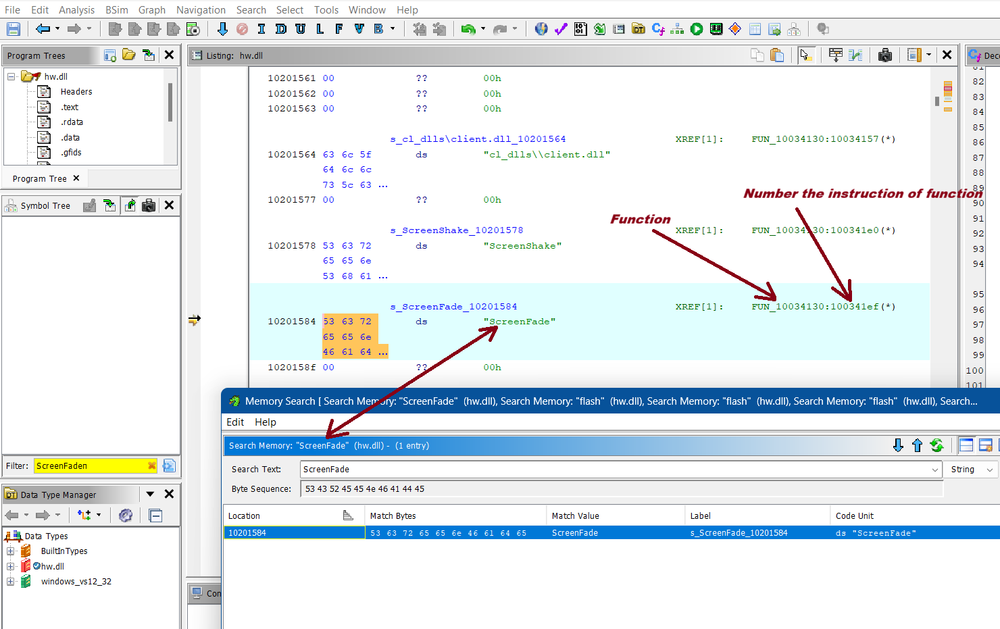
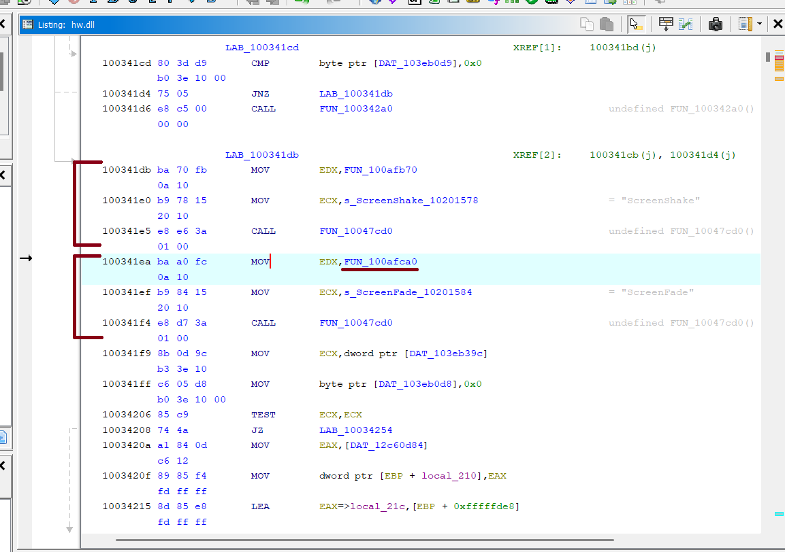

# 💥 Модуль Визуальных эффектов: 

Когда Cheat Engine уже не справляется, но No-Flash все же хочется сделать.

> Cheat Engine, действительно, хороший первый инструмент для начинающего reverse-инженера, но часто и он не справляется, так как, по моему мнению, современные сборки игр стараются максимально защитить внутренности своего продукта, в отличие от старых. Например, если рассматривать совсем старые сборки, то там достаточно просто изменить файлы спрайтов игры, чтобы сделать No-Flash или No-Smoke, когда в современных сборках это, конечно же, не прокатит, так как защита сервера сразу же понимает, что что-то не так. Как только ты находишь это место в Ghidra, перед тобой открывается реальная картина того, как игра обрабатывает ослепление. До того как мне подсказали наводку про ScreenFade, я около месяца безуспешно проводил поиск адресов через Cheat Engine. Игра постоянно приводила в тупик, из-за чего классический анализ не давал результата. Но именно статический анализ в Ghidra помог мне наконец-то понять логику работы движка изнутри и написать надежный No-Flash. Ниже я пошагово разберу этот процесс...

### 🔍 Шаг 1. Изучение внутренностей программы
Если чуть поискать информацию про "ScreenFade", то можно сказать, что это неотъемлемая часть Counter-Strike, отвечающая за отрисовку эффектов.
Таким образом, работая в Ghidra относительно hw.dll, мы можем найти кусок кода, который указывает на функцию, которая в свою очередь указывает на нужную иструкцию.


По поиску строки "ScreenFade" мы изначально попадаем на адрес 100341ef (строка с именем сообщения). Но хукать эту строку нельзя. Нам нужно поднять глаза строго на одну инструкцию выше — на адрес 100341ea. Именно там, в самом начале этого логического блока, игра заносит адрес оригинального обработчика вспышки (FUN_100afca0) в регистр EDX. Его оффсет (0xAFCA0) мы и забираем в наш C++ проект для MinHook.


### 🔍 Шаг 2. Сначала думай - потом делай
Мы написали хук-функцию со стандартным соглашением вызовов `__cdecl`

```cpp
unsigned int __cdecl hk_ScreenHandler(const char* param_1, int param_2, const unsigned char* param_3) {
	if (unloadingFromGame) return o_ScreenHandler(param_1, param_2, param_3);
	bool allowMessage = true; // флаг для понимания, отключать ли белый эффект, по умолчанию true

	for (const auto& [token, callback] : EventBus::screenList) {
		if (!callback(param_1, param_2, param_3)) { // Если среди подписчиков, хотя бы один пришлет false, то выключаем белый эффект
			allowMessage = false;
		}
	}

	if (!allowMessage) {
		return 1; // Возвращаем 1, показывая, что мы успешно перехватили и не дали самой игре отправить нормальные данные
	}

	return o_ScreenHandler(param_1, param_2, param_3);
}
```


